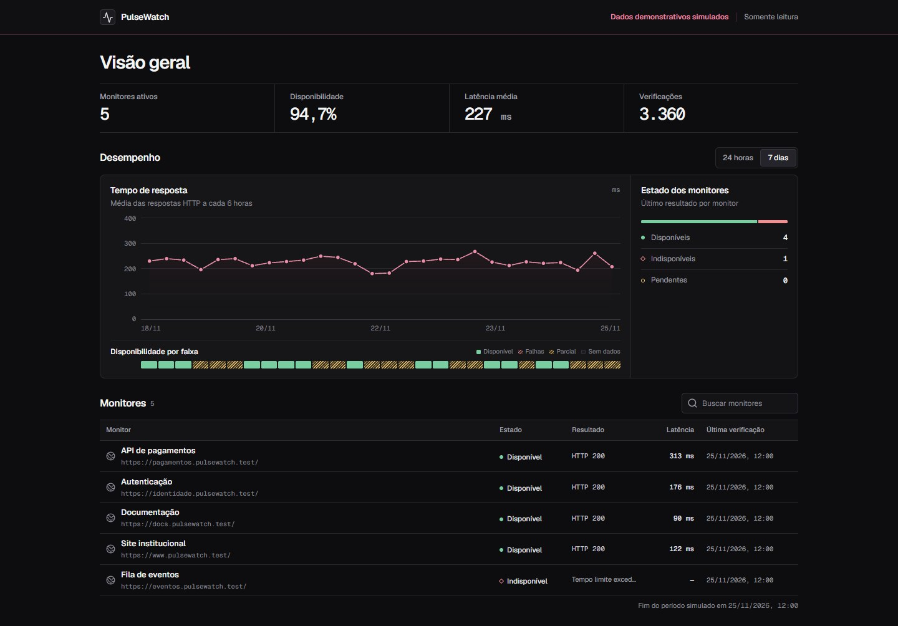
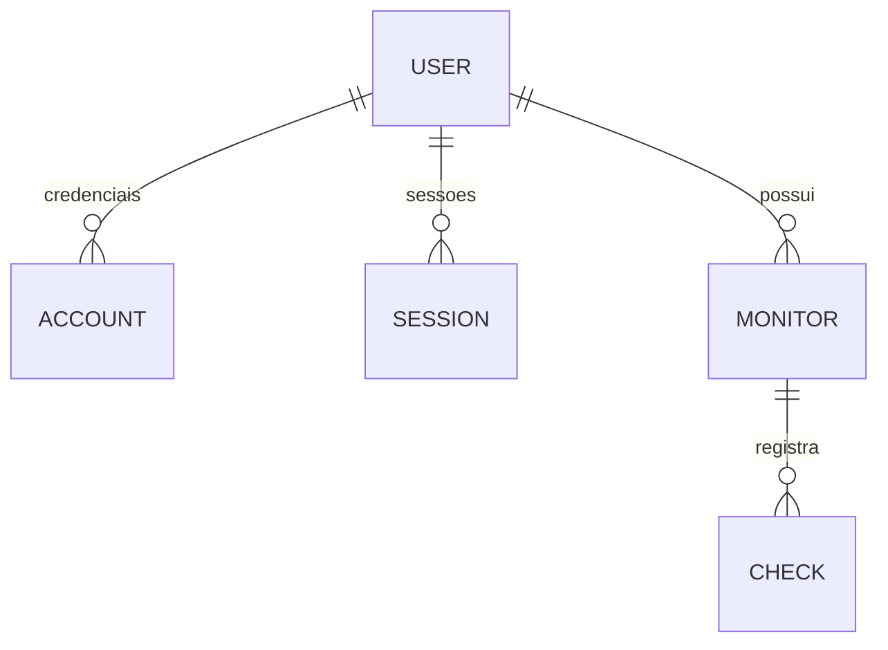

# PulseWatch 1.0

[](https://github.com/oliverzxr/pulsewatch/actions/workflows/ci.yml)
[](LICENSE)
[](package.json)

PulseWatch monitora a disponibilidade e o tempo de resposta de sites e APIs. O sistema completo executa verificações HTTP reais em segundo plano e mantém sessões e históricos separados por conta. A demonstração estática permite explorar o painel, os monitores e seus incidentes com sete dias de dados simulados.



[Detalhes e incidentes da demo](docs/screenshots/demo-monitor.jpg) · [Demo no celular](docs/screenshots/demo-mobile.jpg) · [Login](docs/screenshots/login.jpg) · [Painel com verificação real](docs/screenshots/dashboard.jpg) · [Detalhes com verificações reais](docs/screenshots/monitor-real.jpg)

## Executar localmente

Instale **Node.js 24** e npm no Windows, Linux ou macOS. A CI usa Node 24.21.0. O SQLite vem com o Node.js. Os comandos abaixo funcionam no PowerShell, Bash e Zsh.

```sh
npm ci
npm run dev
```

Abra [a prévia local](http://127.0.0.1:5173/), crie uma conta e entre. O Vite encaminha `/api` ao Node na porta `3001`. Para executar a versão compilada, encerre o desenvolvimento, rode `npm run build` e `npm start`, e abra [o painel compilado](http://127.0.0.1:3001/).

Se o navegador recusar a conexão, confirme que `npm run dev` continua ativo e que as portas `5173` e `3001` estão livres. A [rota de saúde](http://127.0.0.1:3001/api/health) confirma que a API responde. Preserve a pasta `data/` ao reiniciar.

Cadastre apenas endereços públicos que você tem autorização para consultar. A URL completa fica no SQLite e aparece no painel da conta, inclusive a query string. Use URLs sem tokens.

| Variável | Padrão local | Uso |
| --- | --- | --- |
| `PORT` | `3001` | Porta da API e do painel compilado |
| `DATABASE_PATH` | `data/pulsewatch.sqlite` | Arquivo SQLite |
| `CHECK_INTERVAL_MS` | `300000` | Intervalo entre verificações do mesmo monitor |
| `CHECK_TIMEOUT_MS` | `8000` | Prazo total de DNS, conexão, TLS e HTTP |
| `MONITORS_PER_ACCOUNT` | `10` | Limite de novos cadastros por conta |
| `PULSEWATCH_DISABLE_SIGNUP` | Desativado | Use `1` para impedir cadastros HTTP também em loopback |
| `PUBLIC_ORIGIN` | Vazio | Origem HTTPS exata para o modo externo compilado |
| `AUTH_SECRET` | Chave gerada localmente | Segredo aleatório de sessão, obrigatório em modo externo |

Configure as variáveis no processo que inicia o servidor. No PowerShell, use `$env:CHECK_INTERVAL_MS = '60000'`. No Bash ou Zsh, use `export CHECK_INTERVAL_MS=60000`. Para `AUTH_SECRET`, gere um valor com `node -p "require('node:crypto').randomBytes(32).toString('base64url')"` e armazene-o em local privado. Em loopback, a chave gerada fica em `<DATABASE_PATH>.auth-key`. A mesma chave e o mesmo banco permitem restaurar a sessão após reinício.

## Arquitetura e persistência

O frontend é React, TypeScript e Vite. Um servidor HTTP Node.js entrega a API e o build. Better Auth valida as credenciais e mantém sessões revogáveis no SQLite. O agendador roda no mesmo processo e usa quatro vagas de execução e oito de fila globalmente. O ciclo de execução depende do servidor, independentemente da sessão do navegador.



- `user`, `account` e `session` sustentam a autenticação. `rateLimit` mantém os contadores de autenticação. `verification` faz parte do esquema padrão do Better Auth.
- `monitors.owner_id` referencia `user.id`. A combinação de proprietário e URL normalizada é única. `checks.monitor_id` referencia o monitor e a exclusão do monitor remove seu histórico em cascata.
- A API filtra pelo identificador da sessão ao listar, agregar, consultar histórico, executar e remover. Recurso de outra conta e recurso inexistente retornam o mesmo `404`. O agendador escreve somente em monitores que ainda existem.
- O painel e os detalhes de cada monitor mostram janelas de 24 horas e 7 dias. A disponibilidade é calculada sobre as verificações registradas, com lacunas marcadas como “Sem dados”. O verificador envia um `GET`, segue até quatro redirecionamentos e considera disponível uma resposta final `2xx`. A latência mede até os cabeçalhos finais. A lista de verificações mostra até os 100 resultados mais recentes, independentemente do período do gráfico.
- Incidentes são derivados dos registros do monitor. Começam na primeira falha consecutiva, terminam na primeira verificação disponível e aparecem enquanto se sobrepõem ao período selecionado. A duração é medida com base nas observações registradas. Um incidente aberto usa o horário da consulta. Esse método preserva o início de falhas começadas antes da janela do gráfico.
- A página individual usa links com fragmento (`/#/monitores/1`). A API valida a sessão e a propriedade do monitor; o link também funciona na demo estática sem regras de redirecionamento no host.

### Dados de versões anteriores

O servidor migra automaticamente o SQLite em transação. IDs, URLs e verificações do MVP ficam vinculados ao titular reservado `pulsewatch-legacy`, sem credenciais. A operação do agendador continua para esses registros.

Depois de identificar a conta correta e criar seu login, faça backup do banco e transfira explicitamente os registros. Execute o comando com o mesmo `DATABASE_PATH` da aplicação.

```sh
npm run account -- claim-legacy operador@example.com
```

A transferência é atômica. Se alguma URL já existir na conta de destino, a operação preserva todos os dados para que o operador possa resolver a duplicidade. A quota limita os próximos cadastros e não descarta registros transferidos.

### Provisionar uma conta

O operador pode criar contas pelo terminal, inclusive com o cadastro via navegador desabilitado. A senha é passada pela entrada padrão a partir de um prompt oculto.

```powershell
$senha = Read-Host 'Senha para a nova conta' -AsSecureString
[Net.NetworkCredential]::new('', $senha).Password | npm run account -- create 'Operador' operador@example.com
Remove-Variable senha
```

No Linux e no macOS, em Bash ou Zsh:

```sh
printf 'Senha para a nova conta: '
read -rs pulsewatch_password
printf '\n'
printf '%s\n' "$pulsewatch_password" | npm run account -- create 'Operador' operador@example.com
unset pulsewatch_password
```

## Decisões de segurança

- Better Auth mantém o identificador de sessão no cookie `HttpOnly`, `SameSite=Lax` e `Secure` em modo HTTPS. Por padrão, sessões duram sete dias e o logout revoga o registro. Respostas de autenticação não incluem token no JSON. A API consulta a sessão no SQLite e evita cache de dados privados.
- Senhas têm de 12 a 128 caracteres e são armazenadas com Argon2id, 19 MiB de memória, duas iterações e paralelismo 1. Login inválido tem resposta genérica. Cadastros duplicados recebem a mesma resposta de sucesso, e o cadastro local não verifica a titularidade do e-mail.
- Mutações exigem `Origin` autorizado, inclusive login, cadastro e logout. Better Auth também aplica suas verificações de CSRF. O servidor limita por endereço da conexão as tentativas de login e cadastro e limita escritas por conta. Na topologia com proxy, configure também cotas no proxy por IP verificado.
- A verificação usa DNS cancelável para registros A e AAAA, valida endereços privados e reservados, fixa a conexão ao IP aprovado e repete os controles em cada redirecionamento. Usa prazo total, descarta o corpo e encerra a verificação se o monitor for removido.

## Testes

```sh
npm test
npm run typecheck
npm run build
npm run build:demo
npx playwright install chromium
npm run test:browser
```

A suíte Node cobre sessões, expiração, revogação, origem, acesso cruzado, quotas, migração, agendador, métricas e incidentes. O Playwright executa os dois builds em loopback. O sistema completo usa SQLite em memória. Os testes verificam foco, navegação, estados de erro e a ausência de chamadas à API na demo. Se o Chromium precisar de bibliotecas no Linux, use `npx playwright install --with-deps chromium`.

A CI instala, verifica os tipos, executa `npm test` e gera os dois builds em Windows, Linux e macOS. No Linux, executa também o Playwright. O fluxo HTTP real depende de rede externa e só roda quando `PULSEWATCH_TEST_URL` está definida. Use uma URL pública autorizada que retorne `2xx`. No Windows, o Edge instalado pode substituir o Chromium.

```powershell
$env:PULSEWATCH_TEST_URL = 'https://example.com/'
$env:PLAYWRIGHT_CHANNEL = 'msedge'
npm run test:browser
```

```sh
PULSEWATCH_TEST_URL=https://example.com/ npm run test:browser
```

Para recriar as capturas, defina `PULSEWATCH_SCREENSHOTS_DIR` com o caminho absoluto de `docs/screenshots` antes de rodar a suíte. As capturas do login e do painel completo usam uma conta descartável. A captura do painel completo requer o fluxo HTTP real.

## Demonstração estática

```sh
npm run build:demo
npm run preview:demo
```

Abra [a demo local](http://127.0.0.1:4173/). Os cinco monitores, suas URLs `.test`, as latências e os incidentes são simulados e reproduzíveis. O aviso de simulação fica no cabeçalho da visão geral e das páginas individuais. O build é independente do SQLite, da autenticação e do cliente da API.

Após autorização para publicar a demo, envie somente o conteúdo de `dist/demo/` à hospedagem estática. O diretório contém HTML, JavaScript, CSS, fontes e o ícone. A aplicação completa, a pasta `data/`, os backups e a chave de sessão devem ficar fora do pacote.

## Limitações operacionais

Para uma demonstração interativa controlada, use uma instância isolada com um processo Node, armazenamento persistente, HTTPS no proxy e contas criadas pelo operador. Configure `PUBLIC_ORIGIN` e `AUTH_SECRET`. O Node escuta em loopback e exige o `Host` da origem configurada. O cadastro HTTP fica desabilitado no modo externo.

Antes de abrir uma instância interativa, valide o proxy TLS, as cotas por cliente, os backups e a restauração, a revogação de contas e o isolamento de saída. O limite de login usa o IP da conexão e pode ser compartilhado por visitantes atrás do mesmo proxy. O SQLite retém o histórico enquanto o monitor existe. A rota de saúde confirma a resposta do processo, e a operação atual usa um processo por banco.

[Better Auth e sessões](https://better-auth.com/docs/concepts/session-management) · [Proteções do Better Auth](https://better-auth.com/docs/reference/security) · [OWASP e armazenamento de senhas](https://cheatsheetseries.owasp.org/cheatsheets/Password_Storage_Cheat_Sheet.html) · [Auditoria do MVP](docs/auditoria-tecnica.md)

## Licença

O PulseWatch é distribuído sob a [licença MIT](LICENSE).
