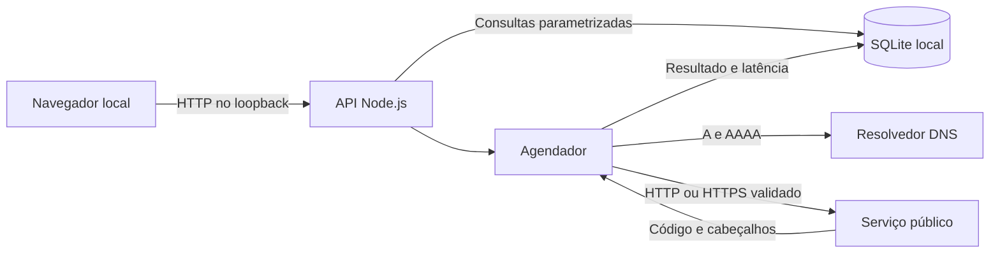

# Auditoria técnica do MVP do PulseWatch

Este relatório registra o estado anterior à versão 1.0. O [README atual](../README.md) descreve as novas fronteiras de autenticação, autorização e persistência.

O PulseWatch usa React e Vite no navegador, uma API HTTP nativa do Node.js e SQLite. A unidade de implantação atual é um processo em loopback com um banco local. A revisão incluiu código de execução, configuração do Vite, dependências, documentação e testes. As prioridades abaixo consideram separadamente o uso individual e a hipótese de exposição pública.

## Achados priorizados

| Gravidade | Evidência e impacto | Situação |
| --- | --- | --- |
| Alta para exposição pública | `src/server/main.ts` vincula o processo a loopback. `src/server/api.ts` valida `Host` e origem, mas as rotas de cadastro, execução, consulta e remoção compartilham a confiança do operador local. Expor essas rotas num proxy público sem autenticação permitiria acesso aos monitores e uso do verificador por terceiros. | Acesso local preservado. Autenticação, autorização e modo somente leitura são requisitos de publicação. |
| Média | O limite de tempo encerrava a espera pela resolução via API do sistema, mas a operação DNS podia continuar após liberar a vaga no agendador. Remover o monitor também deixava a requisição em curso até o timeout. | O resolvedor recebe o mesmo sinal de cancelamento do HTTP. Remover o monitor ou encerrar o processo sinaliza o cancelamento do trabalho ativo. |
| Média | A busca de monitores vencidos aumentava o lote com o tamanho da fila. Sob atrasos persistentes, a carga enfileirada podia crescer mais rápido que a execução. | `src/server/scheduler.ts` limita a quatro execuções e oito entradas pendentes na configuração atual. O cadastro persiste mesmo sob pressão e o agendador recupera os vencidos. Pedidos manuais excedentes recebem `503` para nova tentativa. |
| Média em volume elevado | A consulta do painel fazia duas agregações sobre o mesmo recorte de histórico. O cliente consultava a cada quatro segundos, mesmo fora de foco. | O SQL calcula contagens e somas por faixa numa consulta. A média do período usa respostas individuais como peso. O cliente pausa quando oculto e espaça as consultas ociosas. |
| Baixa no modo local | O build permitia estilos inline na política de conteúdo. O estado vazio do gráfico também aparecia quando a primeira consulta à API falhava. | Política de conteúdo sem a exceção de estilos inline. A interface distingue falha de consulta, carregamento e ausência de medições. |
| Média para crescimento | O SQLite usa consultas síncronas. O tamanho do histórico cresce com os monitores e o tempo. A coordenação do agendador vive na memória de um processo. | Arquivo local com WAL, chaves estrangeiras e índices. Retenção, paginação conforme volume e coordenação entre processos dependem do perfil da futura implantação. |

## Fronteiras de confiança

O navegador entrega nome e URL. O resolvedor entrega endereços, e o serviço externo pode responder com código HTTP, cabeçalhos e redirecionamento. A fronteira mais sensível é a conexão de saída. Os ativos são a rede acessível ao processo, a disponibilidade do agendador e o banco com URLs e histórico. A hipótese atual é um operador local de confiança, com destinos HTTP externos tratados como não confiáveis.

| Risco | Controle e evidência | Risco residual |
| --- | --- | --- |
| SSRF e redirecionamento | `src/server/target.ts` limita protocolos, bloqueia credenciais e rejeita endereços locais, próprios ou de uso especial. `src/server/probe.ts` repete a validação por salto, limita redirecionamentos e descarta o corpo da resposta. | Em infraestrutura hospedada, uma rede separada e uma política de egress devem complementar a classificação feita pela aplicação. |
| DNS rebinding | Todos os endereços retornados são examinados antes de selecionar um. O cliente conecta ao IP aprovado sem fazer outra resolução, mantendo o nome do destino para a validação TLS. | O resolvedor do sistema e a infraestrutura de roteamento continuam sendo parte da fronteira de confiança. |
| Consumo de recursos | Timeout compartilhado por DNS, TCP, TLS e HTTP, fila limitada e uma verificação pendente por monitor. A API limita o tamanho do JSON. | A fila limita simultaneidade. Uma API exposta precisaria de cotas por usuário e destino e de uma política de retenção. |
| Alteração do histórico | Operações SQL parametrizadas, unicidade de URL normalizada, integridade referencial e remoção em cascata. Um resultado de tarefa removida não é persistido. | Um backup é a forma de recuperar exclusões ou falhas de armazenamento. |
| Acesso e exposição de dados | API vinculada a loopback com validação de `Host` e origem de escritas. Componentes React renderizam campos como texto. A interface usa apenas a origem da aplicação. | O armazenamento preserva a URL completa. O operador deve cadastrar endereços públicos sem segredos. |

## Cobertura e escala

- Os testes de backend verificam URLs, respostas DNS mistas, redirecionamentos, prazos, concorrência, cancelamento, persistência e agregação. O transporte controlado nos testes isola casos limítrofes. O teste de navegador com `PULSEWATCH_TEST_URL` percorre o caminho real até o destino público.
- A listagem resume o último resultado por monitor. O histórico individual devolve até 100 registros, e o gráfico agrega 24 ou 28 faixas fixas por consulta. A leitura do painel ainda depende do volume no intervalo escolhido. A varredura dos monitores vencidos e a remoção de históricos longos também merecem medição antes de aumentar a escala.
- O ambiente local tem um processo de API e agendamento para um banco. Várias instâncias exigem coordenação durável das tarefas ou um agendador exclusivo. Em hospedagem com disco efêmero, use armazenamento persistente ou migre a implementação de `MonitorStore`.
- Uma demonstração pública com leitura de monitores mantidos pelo operador tem menos exposição que o cadastro aberto. Uma versão multiusuário exige autenticação, isolamento por conta, cotas, política de saída, backups, observabilidade e testes de carga voltados para a escala escolhida.

Referências técnicas consultadas. [Resolução DNS no Node.js](https://nodejs.org/download/release/latest-v24.x/docs/api/dns.html), [registros IPv4](https://www.iana.org/assignments/iana-ipv4-special-registry) e [IPv6](https://www.iana.org/assignments/iana-ipv6-special-registry) da IANA.
